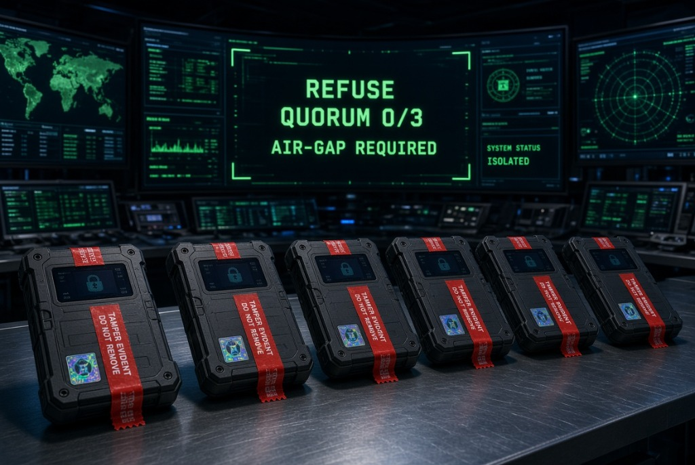
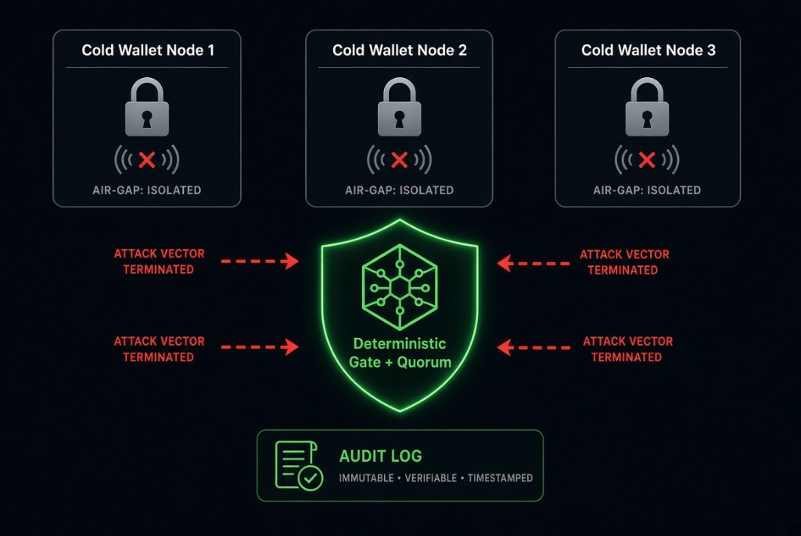
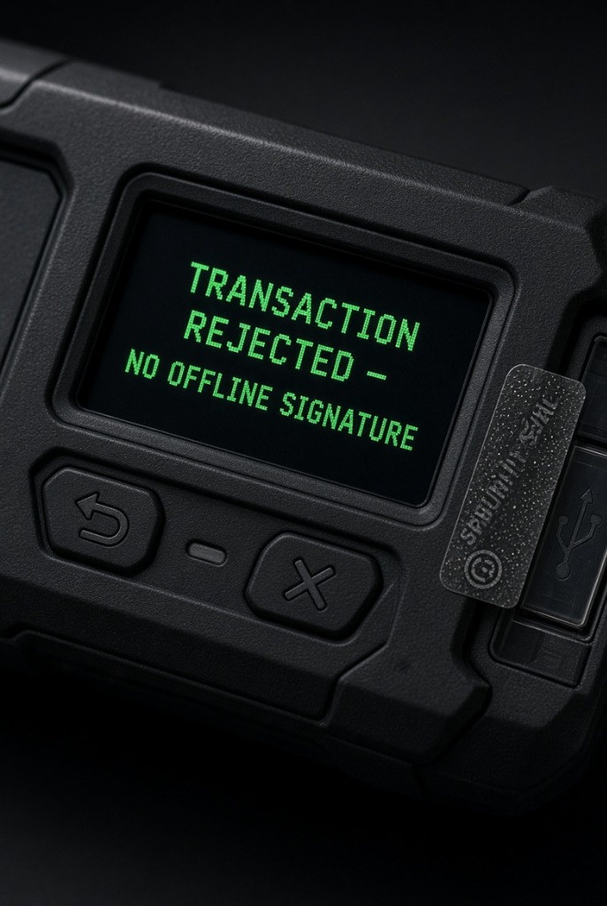

# SVRL Mission Control – Enterprise Cold-Wallet Defense

**Zero-Trust · Deterministic Gate · Air-Gapped HC² Quorum · Immutable Audit**

An interactive defense simulation and architecture view demonstrating how **Sovereign Veritas RL (SVRL)** enforces fail-closed deterministic gating, mandatory physical air-gapped quorum signatures, and independently verifiable audit logging.

---

## Architecture Flowchart

```mermaid
flowchart TB
    subgraph External["External / Untrusted Zone"]
        A[Incoming Transaction<br/>or Verification Request]
    end

    subgraph Gate["Deterministic Gate – Sovereign Veritas RL"]
        B[Capability Check]
        C[Evidence Quality<br/>& Policy Evaluation]
        D[Runtime / Uncertainty<br/>& Risk Checks]
        E{Decision}
        B --> C --> D --> E
        E -->|Insufficient / Policy Fail| F[REFUSE / DEFER]
        E -->|All Checks Pass| G[ALLOW – Proceed to Signing]
    end

    subgraph Cold["Air-Gapped Cold Storage Layer<br/>HC²-style Devices"]
        H[Physical Device 1<br/>Sealed]
        I[Physical Device 2<br/>Sealed]
        J[Physical Device 3<br/>Sealed]
        K{Quorum Check<br/>e.g. 2-of-3 or 3-of-3}
        H & I & J --> K
        K -->|Quorum Not Met| L[REJECT – No Offline Signature]
        K -->|Quorum Met| M[Offline Signatures Collected]
    end

    subgraph Audit["Immutable Audit Layer"]
        N[Evidence Package<br/>+ Decision Record]
        O[Timestamped<br/>Independently Verifiable Log]
        N --> O
    end

    A --> Gate
    F --> N
    G --> Cold
    L --> N
    M --> N

    style F fill:#ff3b5c,color:#fff,stroke:#fff
    style L fill:#ff3b5c,color:#fff,stroke:#fff
    style E fill:#00e5a8,color:#000
    style K fill:#00e5a8,color:#000
    style Gate fill:#1a2332,stroke:#00e5a8
    style Cold fill:#1a2332,stroke:#00e5a8
    style Audit fill:#1a2332,stroke:#8b9bb4
```

### How to Read It
- Everything starts in the **untrusted zone**.
- The **Deterministic Gate** is fail-closed: any missing evidence, policy violation, or uncertainty produces an immediate **REFUSE**.
- Even a successful gate decision still requires **physical, air-gapped device signatures** under a quorum rule.
- Every outcome (allow or refuse) is written to an **immutable, independently verifiable audit log**.
- Remote attack paths terminate at the gate or at the air-gap; they never reach value movement.

---

## Visual Overview

| Mission Control Isolation | Deterministic Gate & Quorum Shield | HC² Hardware Offline Rejection |
| :---: | :---: | :---: |
|  |  |  |
